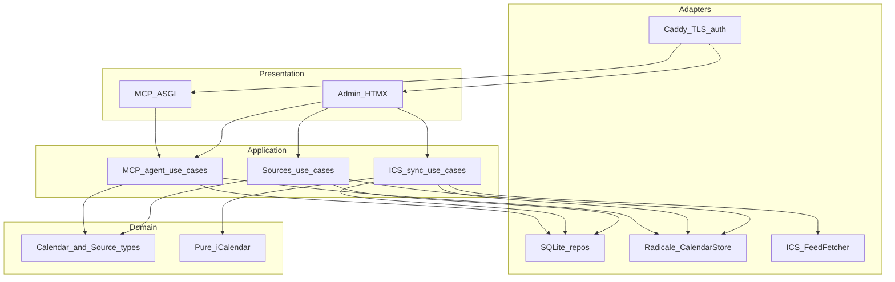

# Target architecture

Exact destination for the calendar-hub refactor. The product is not in active use, so we optimise for a clean cut rather than migration compatibility.

Related: [test-pyramid.md](test-pyramid.md), [plan.md](plan.md).

## Product surface

### Keep

| Surface | Role |
| --- | --- |
| Admin HTMX UI | Owner creates/edits/deletes sources, triggers sync, manages tokens, views health |
| Private calendars | Hub-owned CalDAV collections; clients sync via Radicale as `HUB_USER` |
| External ICS feeds | Hub polls feeds and writes events into read-only `ics-*` collections |
| MCP + tokens | `/mcp` is the only agent surface; `/tokens` UI creates/revokes PATs |
| Litestream + Kopia | SQLite replication + Radicale volume snapshots; health/restore story |

### Drop

| Surface | Reason |
| --- | --- |
| Owner/admin JSON API (`/api/sources`, `/api/sync`, `/api/calendars`, `/api/caldav-info`, …) | UI form/HTMX routes suffice |
| Agent HTTP API (`/api/agent/v1/*`) | MCP covers the same agent use cases |
| Webhook sources and `/api/webhooks/*` | Nothing pushes events from outside |

### Source kinds after cut

- `private` — writable CalDAV collection managed by the hub
- `ics` — pull-only feed; collection path `/{owner}/ics-{id}/`; owner may read events, not write

No `webhook` kind. No Google OAuth columns or leftover OAuth secrets.

## Architecture



### Package layout

```text
app/
  domain/          # Zero imports of FastAPI, SQLAlchemy, http.client, os.environ
  ports/           # typing.Protocol interfaces only
  application/     # Use-cases depending on domain + ports
  adapters/
    sqlite/        # ORM, UnitOfWork, repos, fresh schema
    radicale/      # CalendarStore (REPORT, multiget, pooling)
    http_feed/     # Bounded ICS FeedFetcher + SSRF policy
    ui/            # HTMX/Jinja routes and templates
    mcp/           # MCP ASGI + tool wiring
    crypto/        # AES-GCM for outbound ICS Authorization only
  config.py        # Frozen Settings loaded once at boot
  main.py          # Composition root
```

Cross-cutting that stays thin and injectable: logging/audit, mutation guard (ASGI), i18n (UI only).

### Dependency rules (import-linter)

1. `app.domain` imports nothing from `app.*` except maybe itself.
2. `app.ports` may import `app.domain` only.
3. `app.application` may import `app.domain` and `app.ports` only (no SQLAlchemy, FastAPI, `os`, adapters).
4. `app.adapters.*` implement ports and may call application/domain; UI and MCP adapters call application only.
5. `app.main` wires Settings → adapters → application → ASGI mounts.
6. Presentation must not import sqlite/radicale/crypto modules directly.

### Domain

- Value types: `CalendarEvent`, `CalendarObject`, `CalendarFeed`, marks, windows.
- **Single recurrence field**: `rrules: tuple[str, ...]` (collapse today’s `rrule` + `rrules` split).
- Enums: `SourceKind` (`private` | `ics`), `SyncStatus`, scopes.
- Typed domain errors (`NotFound`, `Validation`, `Conflict`, `Capacity`, `Forbidden`, …) with **no HTTP status codes** and **no i18n catalog keys**.
- Pure functions: iCalendar parse/serialize, feed URL/auth-header validation, snapshot plan (`to_upsert` / `to_delete` / capacity), redirect policy helpers, occurrence expansion with FREQ allowlist and iteration bounds, opaque event-id encode/decode.

### Ports

| Port | Responsibility |
| --- | --- |
| `CalendarStore` | Collection CRUD/properties; get/put/delete event; `list`/`count`; CalDAV `REPORT` calendar-query (time-range) and multiget; connection pooling |
| `SourceRepository` / `MappingRepository` / `SyncStateRepository` / `TokenRepository` / `SecretStore` | Persistence; batch loads; no N+1 session-per-event |
| `FeedFetcher` | Bounded HTTP GET for ICS (size, timeout, redirects, SSRF IP policy) |
| `SyncCoordinator` | Per-source lock, inflight, stop; used by ICS sync **and** MCP writes that touch a calendar |
| `Clock` / `AuditLogger` | Injectable time and mutation audit |
| `Settings` | Immutable config (paths, radicale URL, secrets, timeouts, host) — no runtime `os.environ` in use-cases |

### Application use-cases

- **Sources**: create/update/delete/list private and ICS sources; enable/disable; rotate/clear ICS Authorization header; present data for UI (DTOs without HTML).
- **ICS sync**: due polling, manual start, import plan + apply, cursor/ETag, fail-safe (failed fetch never deletes collection), capacity cap, shutdown.
- **MCP agent**: authenticate PAT (hash + scopes + rate limits); list calendars; list/search/get/create/update/delete events via opaque IDs; confirm-delete store scoped to token; no SQLite writes on read.

HTTP/HX status mapping and i18n strings live only in UI (and MCP error shaping in the MCP adapter).

## Agent event identity (stateless)

- Opaque `event_id` is a deterministic, authenticated encoding of `(source_id, ical_uid)` (e.g. HMAC + URL-safe payload). Verification rejects tampering without a database row.
- **No** hijacking of ICS `EventMapping` for agent IDs.
- **No** SQLite inserts on `GET` / list / search.
- **No** `event_index` projection table (chosen for lower RAM and simpler dual-write story; Radicale remains sole event store).
- Queries use CalDAV `REPORT` with time-range (and multiget where useful), not N sequential `GET`s of every `.ics`.
- MCP writes on a source acquire the same `SyncCoordinator` slot as ICS sync.
- Writable kinds for MCP: `private` only (ICS collections stay read-only for agents and for CalDAV owner write ACL).

## Persistence

SQLite holds:

- `sources` (kinds `private` | `ics` only)
- `source_secrets` (ICS Authorization ciphertext only; **no** webhook secret)
- `event_mappings` (**ICS reconciliation only**: external feed id → stable `ical_uid` / version)
- `sync_states`
- `agent_tokens` (SHA-256 of PAT; scopes; no plaintext storage)

Rules:

- `PRAGMA foreign_keys=ON` and `FOREIGN KEY … ON DELETE CASCADE` on child tables.
- Fresh schema allowed (no production migration burden).
- Drop dead Google OAuth columns and webhook columns.
- Startup DDL/migrations live under `adapters/sqlite`, not scattered in application modules.
- Dual-write ordering: prefer Radicale then SQLite for creates; compensating cleanup documented; deterministic/pre-persisted `ical_uid` for ICS upserts so crash between PUT and remember does not duplicate events.

## Security constraints (design rules)

1. **Owner auth** remains at Caddy for UI; harden so internal Radicale account cannot bypass via case/whitespace on `Authorization` (allowlist owner, do not rely on exact Basic string match alone).
2. **Hub process** should not assume “private network = trusted forever”; mutation guard stays; prefer Origin / Sec-Fetch-Site checks for HTMX mutations.
3. **ICS SSRF**: resolve DNS, reject loopback / private / link-local / metadata IPs on initial URL and every redirect; strip `Authorization` when scheme/host/**port** change; size and redirect caps.
4. **MCP**: Bearer PAT required; rate-limit **failed** auth by client IP; rate-limit successful token use; enforce body size before heavy parse; write scope checked per mutating tool; `calendars:write` semantics documented (include or require explicit read).
5. **Secrets**: PATs hashed; ICS Authorization encrypted (AES-GCM); webhook crypto paths removed; `HUB_SECRET_KEY` only where needed; per-compose-service env scoping (not full `.env` in every container).
6. **Tokens UI**: one-time plaintext reveal with `Cache-Control: no-store`.
7. **Expansion DoS**: restrict RRULE `FREQ` for expansion; bound iteration / distant DTSTART.
8. **Security headers** at edge (frame denial, nosniff, referrer policy; CSP tightened as inline HTMX handlers move).

## Explicit non-goals

- Keeping webhook or agent REST compatibility.
- Building an SQLite event search index.
- Big-bang rewrite without a green suite between slices.
- Rewriting the full test suite before the architecture exists (see [test-pyramid.md](test-pyramid.md) and [plan.md](plan.md)).
